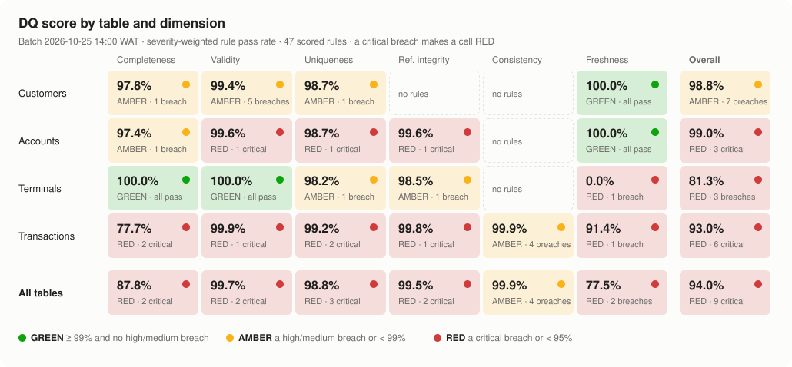
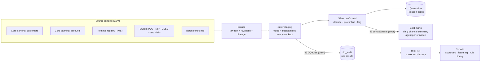

# Data quality for a Nigerian fintech: rules, scorecard and issue log on a dbt + DuckDB medallion

A working DQ framework for agency banking and payments data: POS cash-outs, NIP
transfers, USSD, cards and bills, plus the customer, account and terminal data
behind them. It runs 49 rules across six dimensions, scores every table,
quarantines what would misstate money, and turns each breach into an owned issue
with a root cause.

The data is synthetic, with **35 defects planted on purpose** and recorded in an
answer key that the rules never read. That way the framework can prove what it
catches instead of just claiming it.

---

## The 60-second version

| | |
|---|---|
| **Data** | 72,537 rows from 4 source feeds of a fictional MFB, *NairaRails*: 5,060 customers, 6,630 accounts, 400 POS terminals, 60,447 transactions over 30 days, plus a batch control file |
| **Rules** | 49 dbt tests with owners, severity and actions: 47 scored across completeness, validity, uniqueness, referential integrity, consistency and freshness, plus 2 source-conformity monitors |
| **Detection** | **35 of 35 planted issues caught, every one with the exact expected failing-row count. 0 false positives** on the 15 rules with nothing planted against them |
| **Raw data score** | **94.0%, RED**: 31 of 47 rules breached, 9 of them critical |
| **What reached reporting** | 59,782 clean transactions. 350 duplicates collapsed, 315 quarantined (₦65.9m held back), 165 passed with flags. **26 of 26 silver contract tests pass** |
| **Issues** | 28 issues in the log, each with owner, priority, root cause, impact, remediation and prevention. 5 are P1 |



Read next: [scorecard](reports/dq_scorecard.md) · [issue log](reports/issue_log.md) ·
[rule library](docs/rule_library.md) · [DQ framework](docs/dq_framework.md)

---

## Five findings worth a conversation

These are the kind of findings a DQ analyst exists to surface: small in row count,
large in consequence, and easy to miss without the right rule.

**1. A unit change at a partner would have overstated USSD value 2.5x.**
80 USSD transactions (0.13% of rows) arrived in kobo, not naira. Each one looked
plausible on its own. They were caught by a *consistency* rule (amount above the
customer's KYC tier limit), not a validity rule, and quarantined. Let through,
they would have added ₦55.3m of "successful" value against ₦36.2m of real USSD
value for the whole month. Real value of those 80 rows: about ₦553k.
→ [ISS-002](reports/issue_log.md#iss-002)

**2. 25 customers were debited twice, and a transaction-ID check would never see it.**
Each double posting has two *different* transaction IDs sharing one NIP session
ID. The rule that catches it checks uniqueness on the business key (the session),
not the technical key. The second legs (₦496k) are quarantined and routed for
refund. The prevention ask is specific: make the session ID the ledger's
idempotency key. → [ISS-001](reports/issue_log.md#iss-001)

**3. A whole channel went dark for 30 hours while table freshness stayed green.**
The table-level freshness check passed: POS and transfers kept the latest
timestamp current. Only the per-channel check, driven from an SLA seed so even a
channel with zero rows shows up, flagged that the USSD feed had stopped.
→ [ISS-003](reports/issue_log.md#iss-003)

**4. Fix the cause, not the 45 symptoms.**
45 POS transactions failed referential integrity: their terminals weren't in the
registry. The registry itself was 52 hours stale, and those terminals had been
activated after the last good snapshot. One freshness fix resolves all 45. They
were *flagged, not quarantined*, because they are real cash-outs: dropping them
would understate agent volume. → [ISS-007](reports/issue_log.md#iss-007)

**5. Not every duplicate is a defect.**
`transaction_id` uniqueness fails on 700 rows, but 300 of them are a PENDING row
followed by a SUCCESSFUL row: this feed is change-data-capture. A separate rule
on the payload hash isolates the 400 true double-ingestions. Silver keeps the
latest version of each ID, and the issue log recommends re-pointing the noisy
rule so it stops paging people for normal behaviour. → [ISS-005](reports/issue_log.md#iss-005)

---

## How it works



**Measure at the edge, enforce at the contract.** The 49 DQ rules run on
*staging*, where data is typed and standardised but nothing has been removed, so
the scorecard describes what the sources actually sent. They run at severity
`warn` and never stop the pipeline. Silver then applies each rule's action, and a
separate set of contract tests on silver runs at severity `error`: if one fails,
the build stops before gold is refreshed. That is why the raw feeds score red
while every reporting table is clean.

**Each rule has a decided action, not a blanket policy.**

| Action | What silver does | Example |
|---|---|---|
| QUARANTINE | Withholds the row, records the rule ID | Kobo amounts, double postings, unknown accounts |
| FLAG | Keeps the row, adds the rule ID to `dq_flags` | Unregistered terminals, debits after closure, every KYC defect |
| DEDUPE | Keeps the latest version per key | Re-delivered rows, CDC status updates |
| MONITOR | Measures only | Feed freshness, control totals, tolerated gaps |

**Scoring that can't hide a critical defect.** Each rule's pass rate is weighted
by severity (critical 4, high 3, medium 2, low 1) to score tables, dimensions and
each table × dimension cell. Any critical breach turns a cell RED regardless of
its average, because 25 double debits are 0.04% of rows and still a P1. Full
method: [docs/dq_framework.md](docs/dq_framework.md#scoring).

**Rules are code, and the catalogue is generated from the code.** Each rule is a
dbt test whose `config.meta` carries its ID, dimension, severity, action,
threshold, owner and a one-line *why*. `scripts/render_reports.py` builds the
[rule library](docs/rule_library.md) from the dbt manifest, so the documentation
cannot drift from what runs.

```yaml
- dq_unique:
    name: dq_txn_012_session_id_unique_for_transfers
    config:
      where: "channel = 'TRANSFER'"
      meta:
        rule_id: DQ-TXN-012
        rule_name: One NIP session, one transaction
        dimension: uniqueness
        dataset: transactions
        severity: critical
        action: QUARANTINE
        owner: Settlement & Reconciliation
        why: Two ledger postings for one NIP session is a double debit; the customer has been charged twice.
```

**Nigerian-fintech specifics built in:** NUBAN check-digit validation (CBN
algorithm), BVN format and one-BVN-one-CIF, +234 mobile number standardisation,
the 36 states + FCT with the aliases agents actually type ("Lagos State",
"Abuja", "F.C.T"), CBN bank codes kept as text (leading zeros), illustrative KYC
tier limits, NIP session IDs, POS terminal registry, and West Africa Time.

---

## What a hiring manager can check in this repo

| Senior DQ analyst responsibility | Where it is |
|---|---|
| Define DQ rules and standards across dimensions | [Rule library](docs/rule_library.md) (49 rules), [`models/dq_rules/`](models/dq_rules/), [generic tests](tests/generic/) |
| Set severity, thresholds and tolerances, not just pass/fail | `severity`, `threshold` and `action` on every rule; email completeness is tolerated at 80% |
| Monitor and report quality to stakeholders | [Scorecard](reports/dq_scorecard.md) by dimension, table and cell, with run history; a naira value for every breach |
| Root-cause analysis and remediation with data owners | [Issue log](reports/issue_log.md): 28 issues, each with owner, priority, root cause, impact, remediation and prevention |
| Governance: ownership, SLAs, data contracts | Owner on every rule, [feed SLAs](seeds/ref_feed_sla.csv), control-total reconciliation, conformity monitors as data-contract evidence |
| Protect downstream reporting | Silver quarantine and flags, plus contract tests that block gold |
| Validate the validation | Planted-defect answer key: 35/35 detected with exact counts, 0 false positives |
| SQL and engineering | dbt + DuckDB, reusable macros (NUBAN, phone, timestamps), CI on every push |

---

## Run it

Requires Python 3.10+.

```bash
pip install -r requirements.txt
```

```bash
python run_pipeline.py --as-of "2026-10-25 14:00"
```

That generates the data (seeded, so the numbers above reproduce exactly), builds
bronze → silver → gold, runs every rule and contract test, publishes results and
rewrites `reports/` and `docs/rule_library.md`. It takes about a minute. Omit
`--as-of` to stamp the batch with the current time; freshness results are
relative to the batch, so they stay the same.

Other entry points: `make all` (Unix), or `dbt build --profiles-dir .` to work
on models directly. `dbt docs generate --profiles-dir . && dbt docs serve
--profiles-dir .` shows lineage. The warehouse is a single file,
`warehouse/ng_fintech_dq.duckdb`, so any DuckDB client can query it.

## Repository layout

```
├── run_pipeline.py                 generate → build → publish → score → report
├── scripts/
│   ├── generate_data.py            synthetic feeds + 35 planted defects + answer key
│   ├── publish_dq_results.py       dbt artifacts → dq_audit.rule_results (with denominators)
│   └── render_reports.py           scorecard, heatmap, issue log, rule library
├── models/
│   ├── bronze/                     raw extracts as text + lineage (read_csv external sources)
│   ├── silver/staging/             typed, standardised, every row kept; feed heartbeat; control totals
│   ├── silver/conformed/           dedupe, quarantine, flags; silver contract tests
│   ├── dq_rules/                   the 49 rules, one YAML file per table
│   └── gold/                       marts/ (business) and dq/ (scorecard, history)
├── tests/generic/                  the DQ test library (row-level failures)
├── macros/                         shared predicates (NUBAN, +234 phone, timestamps) and scoring policy
├── seeds/                          states, aliases, CBN bank codes, KYC tiers, feed SLAs
├── dq/issue_triage.yml             root cause, owner, priority and remediation per issue
├── docs/                           DQ framework, generated rule library
└── reports/                        generated scorecard, heatmap, issue log, CSV exports
```

## What I'd build next

- **Alerting:** route critical breaches and per-channel freshness to on-call
  (Slack or PagerDuty) straight from `dq_audit`, instead of reading a report.
- **Accuracy against an external truth:** reconcile settled transfers against
  the NIBSS settlement report and card transactions against scheme files.
- **Anomaly rules:** daily volume and value per channel against a seasonal
  baseline, and amount distribution per source. That would catch the next unit
  change even below a tier limit.
- **Data contracts with source teams:** turn the conformity monitors and the
  prevention column of the issue log into contracts (schema, units, formats,
  SLAs) that are checked at ingestion.
- **Incremental models and a real warehouse:** the same dbt project runs on
  BigQuery or Snowflake by changing the profile, with incremental silver models
  for production volumes.

---

*All data is synthetic and generated by `scripts/generate_data.py`. NairaRails MFB
and its bank code (990) are fictional. Bank codes, state names and the NUBAN
algorithm are public reference data. KYC tier limits are illustrative, modelled
on the CBN three-tier framework, and are not current regulatory thresholds.*
